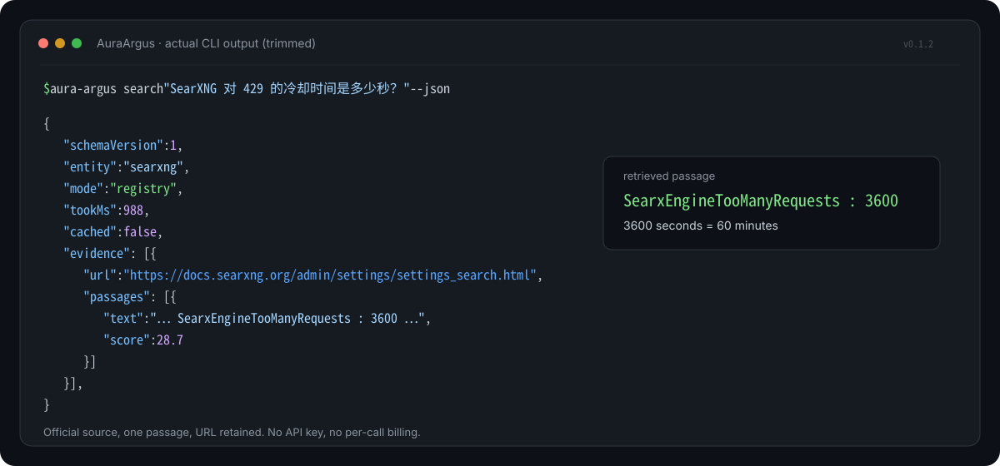
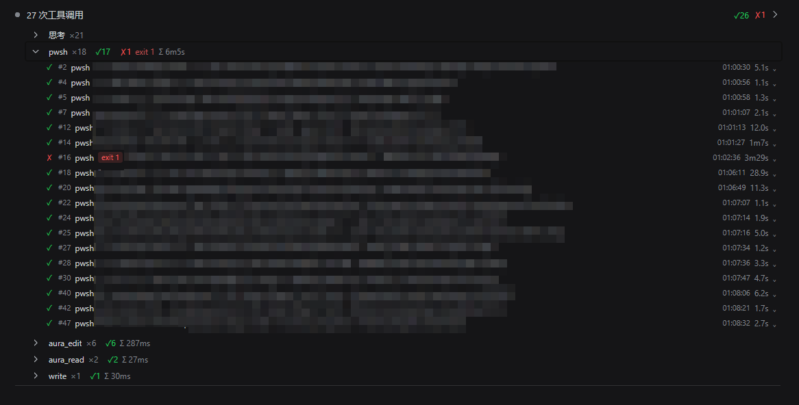

# Aura

[](https://www.npmjs.com/package/aura-argus)
[](https://www.npmjs.com/package/aura-cardea)
[](LICENSE)
[](https://nodejs.org/)

[English](README.md) | 中文

Aura 是一个多包仓库（monorepo），用于维护一组可独立安装的工具。它承担分发与维护边界，而不是共享运行时；每个包拥有独立的 manifest、版本、测试与发布节奏。

以下约束是刻意保留的：

- **本地优先。** 不强制依赖云端账号；除工具显式抓取某个来源外，数据留在本机。
- **尽可能无 key。** AuraArgus 与 AuraCardea 均不需要 API key。
- **可被 agent 调用。** 在适用处提供 CLI、HTTP、MCP 与库接口。
- **MIT。** 代码可读、可修改、可自托管。

---

## 工具

### AuraArgus — 源路由检索层

AuraArgus 将技术问题路由至注册的官方源，抓取页面、抽取相关段落，并返回带 URL 与分值的证据包；也可将任意 URL 转换为干净的 Markdown。

- 当前注册 18 个实体 / 34 个官方源。
- 无 API key、无按次计费、无运行时依赖。
- Node.js ≥ 20；Windows、macOS、Linux。
- 提供 CLI、HTTP、MCP stdio 与 Node 库四种入口。
- npm：[`aura-argus`](https://www.npmjs.com/package/aura-argus)
- 源码：[`aura-argus/`](aura-argus/README.md)



*图为 v0.1.2 的实际输出，仅作截断展示；命令与检索到的原文段落未作修改。*

```bash
npm i -g aura-argus
aura-argus search "SearXNG 对 429 的冷却时间是多少秒？" --json
aura-argus fetch https://docs.searxng.org/dev/search_api.html --max-chars 4000
```

MCP 客户端配置：

```json
{
  "mcpServers": {
    "aura-argus": {
      "command": "npx",
      "args": ["-y", "aura-argus", "mcp"]
    }
  }
}
```

**适用范围。** AuraArgus 是受注册表约束的检索层，不是通用搜索引擎。未注册实体默认不返回证据；网页回退为显式开启，且可能被反爬策略拦截。它不登录、不绕过验证码，也不生成答案；答案由调用方模型基于返回段落撰写。

### AuraCardea — DSH 对话折叠插件

AuraCardea 是 DeepSeek Harness 的 Web 客户端插件。它接管 `conversation.chat.node` 的 `turn-process` 渲染位，将一轮对话中的工具调用、思考、上下文注入与重试等中间态按类折叠为一行。类别行展示成功/失败计数与总耗时；展开后可查看单次调用的参数、输出、退出码与图片缩略图。

- 适用于 DSH 0.2.x Web profile；Node.js ≥ 20。
- npm：[`aura-cardea`](https://www.npmjs.com/package/aura-cardea)
- 源码：[`aura-cardea/`](aura-cardea/README.md)
- 包形态：`dsh.bundle` + `cordis.patch.yml`，并以 `dsh.client` 提供浏览器半。

```bash
dsh plugin --profile web add aura-cardea
```

随后在 `~/.dsh/profiles/web/cordis.patch.yml` 中加入挂载行：

```yaml
- insert:
    - id: client-aura-cardea
      name: 'aura-cardea'
```

重启 `dsh web`。若通过已配置的插件市场以 bundle 方式安装，则 `cordis.patch.yml` 会自动完成挂载。

**适用范围。** AuraCardea 仅适用于 DSH。它不新增检索工具、不改变模型输出，也不提供可移植的聊天界面。它依赖 DSH 的聊天 DOM 契约，而该契约可能随 DSH 版本变化；包内提供 `tools/check-kinds.mjs` 用于检测新增的节点类型。



*AuraCardea 在 DSH 0.2.x 中运行（公开 npm 包）。一轮中的工具调用、思考、编辑与读取按类折叠；类别行显示计数、失败标记与耗时。*

---

## 自测结果

最后验证时间：**2026-10-22**。依赖网络的检查不进入 CI。评测为固定的内部回归集，不是公开基准。

| 包 | 检查 | 结果 |
|---|---|---|
| AuraArgus `0.1.2` | `npm test` | 51 / 51 |
| | `node eval/run.mjs` | 31 题；141 / 141 项硬检查 |
| | `node eval/verify.mjs` | 34 / 34 个注册源可达 |
| | 公开 npm 安装（`npm i -g aura-argus@0.1.2`） | 4 个工具；`initialize` 与 `tools/list` 已验证；CLI `version` 与 `search` 已验证 |
| AuraCardea `1.1.0` | `node tools/check-kinds.mjs` | 19 / 19 个已发现的 kind 均有规则 |
| | `npm pack` | 7 个文件；打包后 23.7 kB |
| | host 导入、client 语法、`npm install` | 已验证 |
| | 公开 profile 安装（`dsh plugin ... aura-cardea@1.1.0`） | 包以 `aura-cardea` 解析；bundle 元数据存在 |
| | 重启后的 DSH UI | 公开 bundle 已加载；折叠视图已验证（见上方截图） |
| | 重启后的 DSH MCP + web provider | MCP `search` 返回注册源证据；`web_search` 返回同一官方源 |

AuraArgus 的 2 项 soft 检查因网页回退为显式开启而默认停用；它们与硬检查分开报告，不计入通过数。

公开包已于 2026-10-22 从 npm registry 安装，并已重启 `dsh web`；上方截图来自该次运行。DSH MCP `search` 返回了注册源证据，DSH web provider 返回了同一官方源。AuraCardea 的界面仍为人工检查，未包含自动化浏览器测试。

复现命令：

```bash
cd aura-argus
npm test
node eval/run.mjs
node eval/verify.mjs

cd ../aura-cardea
npm pack
node tools/check-kinds.mjs <dsh-node-modules>/@deepseek-ai
```

---

## 与其他工具的差异

### AuraArgus：范围比较，不是基准测试

| 维度 | AuraArgus | 通用搜索 API | 无 key SERP | 文档问答机器人 |
|---|---|---|---|---|
| 覆盖 | 注册实体：18 个 / 34 个源 | 广泛网页 | 广泛网页 | 选定的文档语料 |
| 凭据 | 无需 | API key | 无需 | 通常需要账号或 key |
| 计费 | 无 | 按请求计费 | 无 | 视产品而定 |
| 输出 | 带 URL 与分值的原文段落 | 带 URL 的摘要 | 链接与摘要 | 生成式文本 |
| 优势 | 可追溯的官方源证据 | 召回与时效 | 无需 key | 流畅的综合表述 |
| 主要限制 | 不是通用网页索引 | 成本与 key 管理 | 稳定性与反爬拦截 | 出处是间接的 |

AuraArgus 不定位为通用网页搜索的替代品。它适用于问题属于已注册实体、且调用方需要官方源可引用段落的情形。若目标是开放网页的广泛召回，通用搜索 API 仍是更合适的工具。

### AuraCardea：展示层，不是聊天平台

| 维度 | AuraCardea | DSH 默认聊天渲染 |
|---|---|---|
| 适用范围 | DSH 0.2.x Web | DSH Web |
| 中间态 | 按类折叠，显示计数、耗时与内联详情 | 作为独立行展示 |
| 可移植性 | 仅 DSH | 仅 DSH |
| 模型行为 | 不变 | 不变 |
| 遥测 | 不新增 | 不适用 |

AuraCardea 不声称提升模型质量。它改变的是既有轮次的密度与可扫读性，代价是与 DSH 聊天 DOM 耦合。

---

## 获取源码

安装包不需要克隆本仓库。如需检查源码：

### 稀疏检出

```bash
git clone --filter=blob:none --sparse https://github.com/Ck-epsilon/Aura.git
cd Aura
git sparse-checkout set aura-cardea
```

将 `aura-cardea` 替换为 `aura-argus` 即可获取另一个包。

### degit

```bash
npx degit Ck-epsilon/Aura/aura-cardea aura-cardea
```

### 包管理器

```bash
npm i -g aura-argus
npm i aura-cardea
```

---

## 仓库结构

```text
Aura/
  README.md
  README.zh.md
  LICENSE
  docs/assets/
  aura-argus/          # 检索层：CLI / HTTP / MCP / Node 库
  aura-cardea/         # DSH Web 客户端插件
```

每个包均可独立发布，其 manifest 指回本仓库：

```json
"repository": {
  "type": "git",
  "url": "https://github.com/Ck-epsilon/Aura",
  "directory": "aura-cardea"
}
```

---

## 约定

- **npm 名称：** `aura-<product>`（`aura-argus`、`aura-cardea`）。
- **产品名称：** 文案与界面使用 `AuraXxx`。
- **版本：** 每个包独立 semver；推荐 tag 形如 `aura-cardea-v1.1.0`。
- **DSH 包：** 同时声明 `dsh.bundle` 与 `dsh.client`，并以 `engines.dsh` 标注支持的 DSH 范围。
- **不共享运行时：** 包之间不互相依赖；宁可保留少量重复，也不过早抽取公共层。
- **不强制根 workspace：** 每个包均可单独测试、单独发布。

---

## 状态

| 包 | 版本 | 运行环境 | 说明 |
|---|---|---|---|
| AuraArgus | `0.1.2` | Node.js ≥ 20 | 默认仅注册表；网页回退需显式开启 |
| AuraCardea | `1.1.0` | DSH 0.2.x Web | bundle + client；可手动或经市场安装 |

当前没有从本仓库发布其他包。

---

## 许可与第三方声明

本仓库原创代码以 MIT License 发布；见根目录 [`LICENSE`](LICENSE) 及各包的 `LICENSE`。

包内涉及的第三方名称、商标与作品归各自权利人所有。MIT 仅覆盖原创代码，不授予任何第三方知识产权许可。
